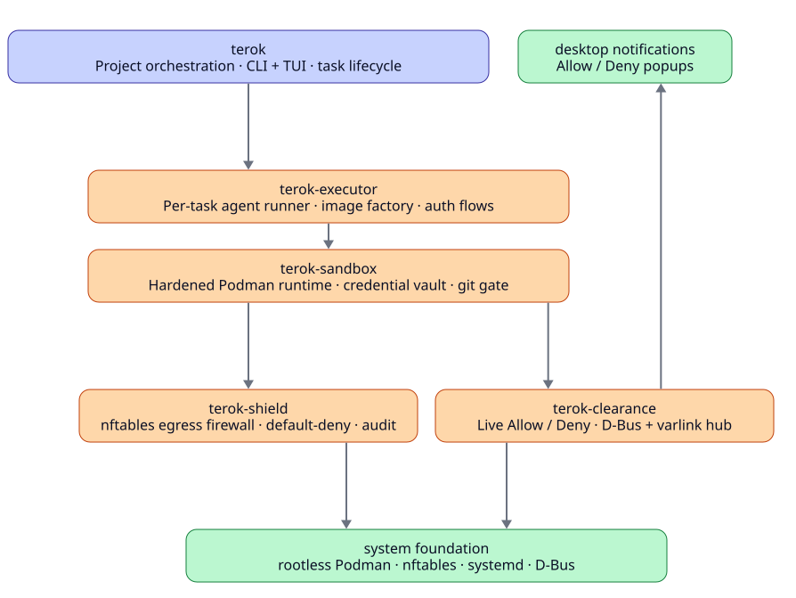
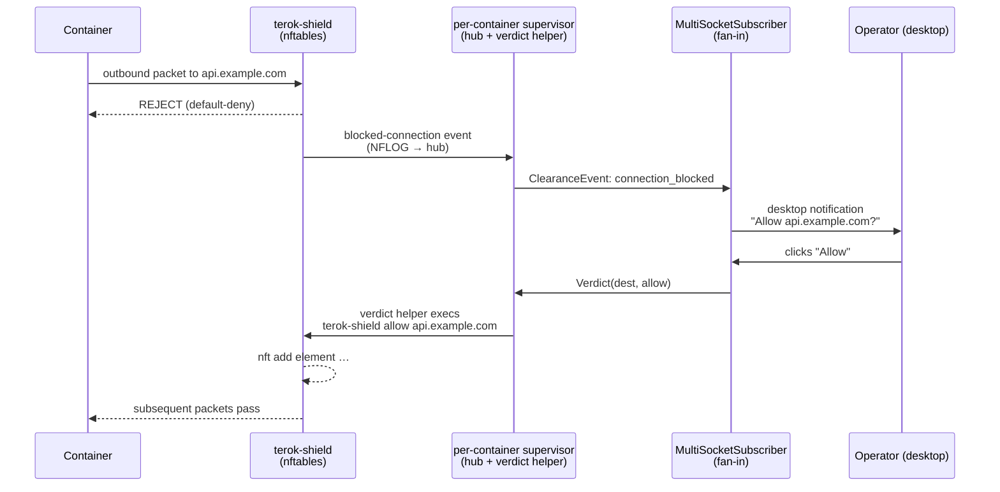

# terok-clearance

Live allow/deny prompts for [terok-shield](https://github.com/terok-ai/terok-shield),
[terok](https://terok-ai.github.io/terok/)'s egress firewall — a per-container
varlink hub and verdict helper, fanned into desktop notifications.

When a hardened terok container hits a blocked outbound destination,
the operator sees a desktop notification with **Allow** and **Deny**
buttons; the chosen verdict is written into the running nftables
ruleset.  No restart, no shell into the container, no editing config
files.



## What is the clearance system

The clearance system is the operator-in-the-loop decision path for
terok's egress firewall.  Each hardened container runs its own
**supervisor** (provided by terok-sandbox) that composes two
varlink components in-process — the **hub** (event bus) and the
**verdict helper** (the `terok-shield allow|deny` exec path) — on a
per-container Unix socket.  Operator UIs fan every supervisor's
event stream into one place and surface decisions through the
freedesktop Notifications D-Bus interface:



The per-container layout is deliberate.  Each supervisor owns one
container's hub and verdict helper, so a container's lifecycle,
sockets, and privileged exec surface stay isolated from every other
container.  Within a supervisor the **hub** is the event bus and the
only stateful component; its socket is bound same-UID-only (mode
0600) and every verdict must cite a triple the hub itself emitted.  The
**verdict helper** is the only piece that execs into the container's
shield, so it is held to one stateless method and isolated from the
receive path.  On the operator side, a single **notifier** is a thin
desktop bridge that fails gracefully on headless hosts, and
[`MultiSocketSubscriber`][terok_clearance.MultiSocketSubscriber]
multiplexes across every per-container hub socket so the operator
sees one merged stream.

## Key properties

- **Async-first** — built on `dbus-fast` with native asyncio
- **Action buttons** — notifications carry interactive actions
  (Allow / Deny)
- **Signal handling** — listen for `ActionInvoked` and
  `NotificationClosed`
- **Graceful fallback** — `create_notifier()` returns a silent
  `NullNotifier` when D-Bus is unavailable (headless, container, CI)
- **Protocol-based** — consumers type-hint against `Notifier`
  (PEP 544 Protocol)
- **Mute without fail-open** — `SetMute(container, muted)` stops the
  Allow/Deny prompts for one container and `Mutes()` reads the state
  back.  The refusal already happened in the kernel; muting changes who
  is asked, never what the shield did.  Nothing is auto-allowed.  The
  refusal is still recorded in the container's audit log while the
  task's shield audit is enabled — see below for audit off

## Muting a container's prompts

A container is addressed by the key its events carry in
`ClearanceEvent.container`: under the terok supervisor, the **12-char
short container id** the shield reader stamps on everything it emits.
The same id names the hub's socket directory
(`$XDG_RUNTIME_DIR/terok/clearance/<short_id>/hub.sock`).  The podman
name and the task name are display labels; muting by them would
silence nothing, so a hub launched for one container
(`ClearanceHub(container=<short id>, aliases=…)`) refuses any key it
cannot match with an `UnknownContainer` error.  That hub also stamps every
event it ingests with the short id, so host-side shield events sent under
the podman name land on the same identity as the reader's.  The short id
is also the only value `container=` accepts.  A podman name or the full
id raises `ValueError` when the hub is constructed.  A single string
passed as `aliases=` or `muted=` raises `TypeError`, because it would be
split into one key per character.

| Call | Use it when | On failure |
|------|-------------|------------|
| `set_container_mute(socket, short_id, muted)` | one-off action, no live subscription | raises |
| `container_mutes(socket)` | read the mute set back, no subscription | raises |
| `ClearanceClient.set_mute` / `.mutes()` | inside a live subscriber | returns `None` = unknown |
| `MultiSocketSubscriber.set_mute(short_id, muted)` / `.is_muted(short_id)` | across every per-container hub | returns `None` = unknown |

`None` and a raised error both mean *the state is unknown* — show that,
never "audible".  Hubs that predate `Mutes()` answer
`org.varlink.service.MethodNotFound`, which lands in the same bucket.

The mute set lives in the hub's memory.  `ClearanceHub(muted=[short_id])`
seeds it before the hub starts listening, so a container can start muted
with no first prompt slipping out; the per-container supervisor rebuilds
the hub on every container start, so a restart returns to that launch
default and a runtime mute ends with the hub that held it.

A mute does not affect whether a refusal is recorded; that depends only
on the task's shield audit setting.  The shield reader writes each
refusal to the container's audit log only while that audit is enabled.
**A muted container with audit disabled keeps no record of its refusals.**
Nobody is asked and nothing is logged, though the connections are still
refused.  If the refusals matter later, for example to harvest them into
an allowlist, leave audit on.  terok-shield's harvest reports a task
with audit disabled as such, not as "nothing harvested", so the gap is
visible.

## When a verdict fails

When `terok-shield` refuses a verdict, the hub fans the outcome out to
every subscriber as a `verdict_applied` event with `ok` false.  The event
also carries shield's stderr, sanitised, in its `reason` field, and the
popup comes from this event.  The `Verdict` caller's error reply goes to
that caller only.  The red "Allow failed" or "Deny failed" popup therefore
shows shield's message under the task line, in the desktop notifier, the
terminal UI and any `EventSubscriber`-based screen alike.  This matters
most when the security tier refuses an Allow, for example for a
vault-relayed provider host.  Shield's message then says the only way
through is a `shield.override` with a reason and an expiry.

## Quick start

### Install

```bash
pip install terok-clearance
```

### Send a notification

```python
import asyncio
from terok_clearance import create_notifier


async def main():
    notifier = await create_notifier(app_name="terok")
    action_received = asyncio.Event()

    def on_action(action_key):
        print(action_key)
        action_received.set()

    nid = await notifier.notify(
        "Clearance request",
        "Task alpha wants access to api.github.com:443",
        actions=[("allow", "Allow"), ("deny", "Deny")],
    )
    await notifier.on_action(nid, on_action)

    await action_received.wait()
    await notifier.disconnect()


asyncio.run(main())
```

### CLI tool (development / testing)

```bash
terok-clearance-hub notify "Title" "Body"   # one-shot desktop notification
terok-clearance-hub serve                   # run a clearance hub
terok-clearance-hub serve-verdict           # run the verdict helper
terok-clearance-hub clearance               # interactive terminal UI
```

## API preview

| Symbol | Description |
|--------|-------------|
| `create_notifier()` | Async factory — returns `DbusNotifier` or `NullNotifier` |
| `DbusNotifier` | Real D-Bus client via `dbus-fast` |
| `NullNotifier` | No-op fallback (all methods return immediately) |
| `Notifier` | PEP 544 Protocol for consumer type hints |
| `ClearanceHub`, `ClearanceClient`, `EventSubscriber` | Varlink hub + subscriber API |
| `MultiSocketSubscriber` | Fan-in subscriber across every per-container hub socket |
| `set_container_mute()`, `container_mutes()` | One-shot mute and mute read-back against one hub socket |
| `VerdictServer` | Embeddable verdict-helper varlink server (composed by the supervisor) |

## Next steps

- [Contributing](developer.md) — development setup and conventions
- [API Reference](reference/) — full module documentation
